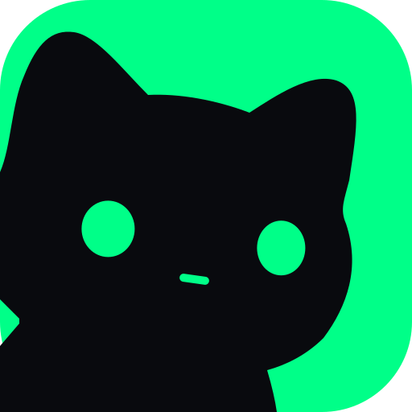

  
  
  

### Stack

**Cloud & Kubernetes**

    

**Observability**

   

**Languages**

**Fullstack**

<a href="https://github.com/Danzokka/TCC-Estufa">TCC-Estufa</a> · <a href="https://github.com/Danzokka/portfolio">portfolio</a> · <a href="https://danzokka.com">danzokka.com</a>

### GitHub

  
  

  

// carousels and short videos about DevOps at <a href="https://instagram.com/dan_the_dev">@dan_the_dev</a>

